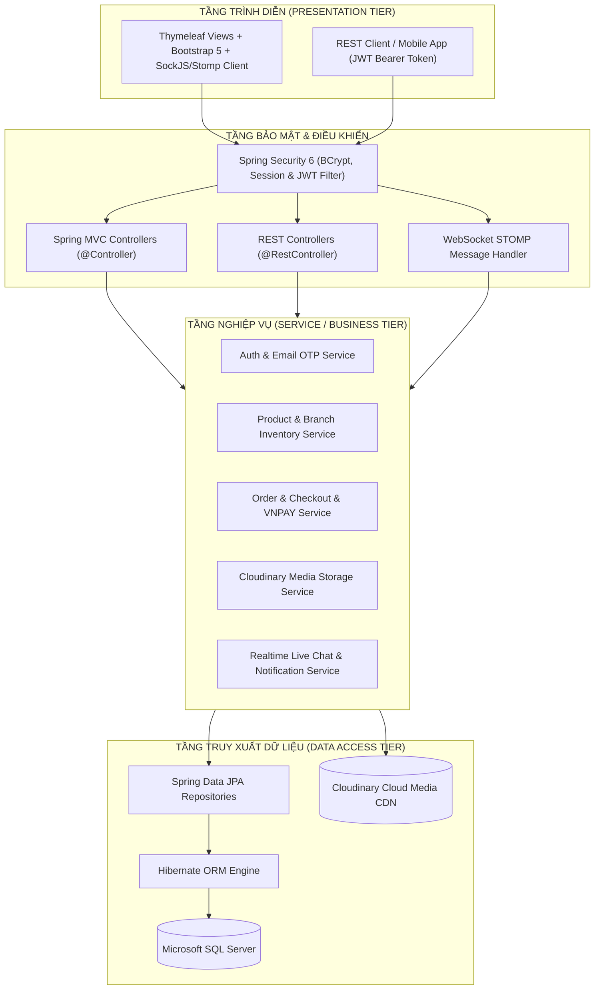

# 📱 ĐỒ ÁN CUỐI KỲ: HỆ THỐNG WEBSITE BÁN HÀNG THEO MÔ HÌNH CHUỖI CỬA HÀNG THIẾT BỊ ĐIỆN TỬ

> **Môn học:** Lập trình WEB  
> **Trường Đại học:** Đại học Công nghệ Kỹ thuật Thành phố Hồ Chí Minh  
> **Khoa:** Công nghệ Thông tin  
> **Thời gian báo cáo:** 7h00 - 18h00 ngày 31/10/2026 tại phòng A5-203  
> **Số thứ tự nhóm:** `Nhóm 24`  
> **Mã đề tài:** `27`  
> **Đề tài:** **Xây dựng website bán hàng theo mô hình chuỗi cửa hàng thiết bị điện tử bằng Spring Boot + Thymeleaf + Bootstrap + JPA + SQLServer + WebSocket + JWT + Cloudinary**  
> **Repository GitHub:** [https://github.com/24110257ak/LTW-Do-an-cuoi-ki.git](https://github.com/24110257ak/LTW-Do-an-cuoi-ki.git)  

---

## 👥 1. THÀNH VIÊN THỰC HIỆN & PHÂN CÔNG NHIỆM VỤ (NHÓM 24)

*(Phần phân công nhiệm vụ chi tiết sẽ được cập nhật và hoàn thiện theo tiến độ thực tế)*

| STT | Mã sinh viên | Họ và tên | Vai trò | Phân công Module |
| :---: | :---: | :--- | :---: | :--- |
| **1** | `24110257` | **Trần Vũ Anh Khoa** | *(Cập nhật sau)* | *(Cập nhật sau)* |
| **2** | `24110292` | **Mai Huy Nhật** | *(Cập nhật sau)* | *(Cập nhật sau)* |
| **3** | `24110304` | **Đặng Nhật Phúc** | *(Cập nhật sau)* | *(Cập nhật sau)* |

---

## 🎯 2. TIÊU CHÍ ĐÁNH GIÁ ĐỒ ÁN (THANG ĐIỂM 10)

| Tiêu chuẩn đánh giá | Trọng số | Nội dung đáp ứng của Đồ án Nhóm 24 |
| :--- | :---: | :--- |
| **1. Quản lý Git & Phân công nhiệm vụ** | **1.0 đ** | Phân công nhiệm vụ rành mạch, tuân thủ Git Flow chuẩn (`main`, `develop`, các nhánh `feature/*`), lịch sử commit minh bạch. |
| **2. Cấu trúc Project đúng chuẩn 3 tầng** | **0.5 đ** | Chuẩn Spring Boot 3-tier: Controller (Web & API) - Service - Repository - Entity/DTO, phân chia package mạch lạc. |
| **3. Nghiệp vụ, Logic, Validation & Security** | **6.0 đ** | Đầy đủ 5 roles (Guest, User, Vendor/Store Manager, Admin, Shipper), xử lý validation đầy đủ (`jakarta.validation`), bảo mật Spring Security 6 + OTP kích hoạt qua Email. |
| **4. Giao diện Đẹp, Thân thiện & Responsive** | **1.0 đ** | Template Bootstrap 5.3 hiện đại, tối ưu di động, máy tính bảng và desktop, trải nghiệm mượt mà. |
| **5. Tính năng Sáng tạo & Nâng cao** | **1.0 đ** | - Xác thực bảo mật kép với **JWT**.<br>- **WebSocket STOMP** thông báo đơn hàng realtime và Livechat tư vấn.<br>- Tích hợp lưu trữ CDN **Cloudinary**.<br>- Thanh toán trực tuyến **VNPAY Sandbox**.<br>- Hệ thống Quản lý **Chuỗi cửa hàng & Tồn kho đa chi nhánh (Multi-branch Inventory)**. |
| **6. Khả năng Báo cáo & Trả lời phản biện** | **0.5 đ** | Báo cáo chi tiết, video demo rõ mặt 3 thành viên, nắm vững source code và kiến trúc. |

---

## 🏛️ 3. KIẾN TRÚC HỆ THỐNG & CÔNG NGHỆ BẮT BUỘC

### 3.1. Sơ đồ Kiến trúc 3 Tầng (3-Tier Architecture)



### 3.2. Ngăn xếp công nghệ (Technology Stack)
- **Backend:** Java 17 LTS, Spring Boot 3.3.4
  - `spring-boot-starter-web`
  - `spring-boot-starter-data-jpa`
  - `spring-boot-starter-security`
  - `spring-boot-starter-validation`
  - `spring-boot-starter-mail` (Gửi mã OTP xác thực đăng ký / đổi mật khẩu)
  - `spring-boot-starter-websocket` (STOMP Protocol Realtime)
  - `com.cloudinary:cloudinary-http44:1.38.0` (Lưu trữ ảnh mây)
  - `io.jsonwebtoken:jjwt` (JWT Token)
- **Database:** Microsoft SQL Server 2019/2022 + SSMS
- **Frontend:** Thymeleaf 3, Bootstrap 5.3, Bootstrap Icons, FontAwesome 6, Chart.js, SockJS, STOMP.js
- **Build tool:** Apache Maven

---

## 🏬 4. CHI TIẾT TÍNH NĂNG THEO TỪNG VAI TRÒ (ROLES)

### 4.1. Khách vãng lai (Guest)
- Xem trang chủ với danh sách sản phẩm nổi bật, sản phẩm bán chạy (>10 sản phẩm sắp xếp giảm dần).
- Tìm kiếm từ khóa theo tên máy, hãng sản xuất (Apple, Samsung, Asus, Dell, Sony,...).
- Lọc sản phẩm theo danh mục, khoảng giá, trạng thái còn hàng tại các chi nhánh.
- Xem chi tiết sản phẩm: hình ảnh, thông số kỹ thuật, giá theo phiên bản (ROM/RAM/Màu), các chi nhánh cửa hàng đang còn hàng sẵn.
- Đăng ký tài khoản người dùng mới: Nhập thông tin -> Hệ thống tự động phát sinh **mã OTP và gửi qua Email** -> Xác thực OTP kích hoạt tài khoản.
- Đăng nhập (Session Web hoặc API cấp JWT).
- Quên mật khẩu: Nhập email -> Nhận mã OTP qua Email -> Đặt lại mật khẩu mới được mã hóa BCrypt.

### 4.2. Khách hàng đã đăng nhập (User / Customer)
- **Trang cá nhân (Profile):** Quản lý thông tin, đổi ảnh đại diện (Cloudinary), đổi mật khẩu, **sổ địa chỉ nhận hàng đa điểm** (địa chỉ nhà, công ty, ghi chú).
- **Trang mua sắm & Khám phá:** Phân trang 20 sản phẩm/trang theo tiêu chí (Mới nhất, Bán chạy nhất, Đánh giá cao nhất, Yêu thích nhất).
- **Yêu thích & Đã xem:** Thêm sản phẩm vào danh sách Yêu thích (Wishlist), lưu lịch sử Sản phẩm đã xem gần đây.
- **Giỏ hàng lưu trữ Database:** Giỏ hàng đồng bộ trên tài khoản, chọn số lượng, chọn biến thể, tự động tính tổng tiền.
- **Mã giảm giá (Coupon / Voucher):** Nhập mã khuyến mãi để được trừ trực tiếp số tiền hoặc % đơn hàng.
- **Đặt hàng linh hoạt (Checkout):**
  - *Hình thức 1:* **Giao hàng tận nhà** (Chọn địa chỉ nhận hàng, chọn phương thức vận chuyển).
  - *Hình thức 2:* **Nhận tại chi nhánh (Click & Collect)** (Chọn chi nhánh cửa hàng thuận tiện nhất để ra nhận máy).
  - *Phương thức thanh toán:* COD (Thanh toán khi nhận hàng) hoặc VNPAY Sandbox (Cổng thanh toán thẻ ATM / QR code).
- **Lịch sử đơn hàng (Order History):** Theo dõi đơn hàng theo 6 trạng thái chuẩn:
  1. `NEW` (Đơn hàng mới)
  2. `CONFIRMED` (Đã xác nhận)
  3. `SHIPPING` (Đang giao hàng)
  4. `DELIVERED` (Đã giao thành công)
  5. `CANCELLED` (Đã hủy)
  6. `RETURNED_REFUND` (Trả hàng - Hoàn tiền)
- **Đánh giá & Bình luận sản phẩm:** Khách hàng chỉ được đánh giá các sản phẩm đã mua thành công; bình luận hỗ trợ nhập nội dung chi tiết (tối thiểu 50 ký tự) kèm tải ảnh thực tế (Cloudinary).
- **Live Chat tư vấn:** Khung chat trực tuyến thời gian thực (WebSocket) trò chuyện với tư vấn viên chi nhánh.

### 4.3. Quản lý Chi nhánh / Cửa hàng (Vendor / Store Manager)
- Đăng nhập vào trang quản trị Chi nhánh chuyên biệt.
- **Quản lý Kho hàng Chi nhánh (Branch Stock Management):** Nhập số lượng tồn kho từng sản phẩm/biến thể tại chi nhánh mình quản lý.
- **Xử lý Đơn hàng Chi nhánh:**
  - Tiếp nhận đơn hàng giao từ chi nhánh hoặc đơn khách hẹn nhận tại chi nhánh.
  - Cập nhật trạng thái: Đơn mới -> Xác nhận -> Đã đóng gói/Lấy hàng -> Bàn giao Shipper.
  - Nhận thông báo **Realtime (WebSocket)** chuông ting-ting ngay khi có khách đặt đơn mới tại chi nhánh mình.
- **Chương trình khuyến mãi chi nhánh:** Tạo mã Voucher giảm giá áp dụng riêng cho khách mua tại chi nhánh.
- **Báo cáo Doanh thu Chi nhánh:** Biểu đồ doanh thu ngày, tuần, tháng và top sản phẩm bán chạy nhất tại cửa hàng.
- **Live Chat Support:** Tiếp nhận tin nhắn tư vấn từ khách hàng và phản hồi trực tiếp thời gian thực.

### 4.4. Quản trị viên Toàn chuỗi (Admin / HQ Manager)
- **Quản lý Tài khoản (User Management):** Xem danh sách, kích hoạt, khóa/mở khóa tài khoản, phân quyền Role (CUSTOMER, STAFF, SHIPPER, ADMIN).
- **Quản lý Hệ thống Chi nhánh (Branch Management):** Thêm/sửa/xóa thông tin chi nhánh cửa hàng (Tên, Địa chỉ, Tọa độ, Hotline, Ảnh đại diện chi nhánh).
- **Quản lý Danh mục & Thương hiệu:** CRUD danh mục (Điện thoại, Laptop, Tablet, Phụ kiện, Smartwatch), CRUD hãng sản xuất (Apple, Samsung, Dell, Lenovo,...).
- **Quản lý Sản phẩm chung:** CRUD sản phẩm, thông số kỹ thuật, biến thể (Màu, RAM, ROM, Giá niêm yết, Giá khuyến mãi), tải album ảnh lên Cloudinary.
- **Quản lý Đơn vị Vận chuyển:** Quản lý nhà vận chuyển (Giao Hàng Nhanh, Viettel Post, Chuỗi giao hỏa tốc) và bảng phí vận chuyển.
- **Quản lý Chiết khấu & Khuyến mãi:** Quản lý voucher toàn hệ thống, cấu hình tỉ lệ chiết khấu chi nhánh.
- **Báo cáo Thống kê Toàn diện (Dashboard):** Biểu đồ doanh thu tổng chuỗi, so sánh doanh thu giữa các chi nhánh, thống kê tỉ lệ đơn thành công/hủy, top khách hàng VIP.

### 4.5. Nhân viên Giao hàng (Shipper - Module Mở rộng)
- Nhận danh sách các đơn hàng được gán đi giao thuộc chi nhánh.
- Cập nhật trạng thái: Đang giao -> Đã giao thành công / Khách hẹn giao lại / Giao thất bại.
- Xem thống kê số lượng đơn đã giao thành công và tiền COD cần nộp lại cho chi nhánh.

---

## 🌿 5. CHIẾN LƯỢC PHÂN NHÁNH GIT (GIT FLOW STRATEGY)

Để đảm bảo đạt điểm tối đa tiêu chí *"Quản lý, phân công nhiệm vụ các thành viên và có quá trình commit Github"* (1.0 điểm), nhóm triển khai mô hình Git Flow bài bản:

```
main (Phiên bản phát hành chính thức, sẵn sàng chấm điểm)
  │
  └── develop (Nhánh tích hợp tổng thể)
        │
        ├── feature/database-model-and-setup    (Khởi tạo CSDL, Entities, JPA, Seed Data)
        ├── feature/security-jwt-and-email-otp  (Spring Security 6, JWT, OTP Email kích hoạt)
        ├── feature/cloudinary-service          (Cloudinary Service upload media)
        ├── feature/product-and-branch-stock    (Quản lý Sản phẩm, Biến thể, Tồn kho Chi nhánh)
        ├── feature/guest-and-user-portal       (Trang chủ, Lọc, Chi tiết, Profile, Sổ địa chỉ)
        ├── feature/cart-and-checkout-order     (Giỏ hàng DB, Đặt hàng, VNPAY, Lịch sử 6 trạng thái)
        ├── feature/vendor-store-management     (Portal quản lý chi nhánh, duyệt đơn, doanh thu)
        ├── feature/admin-system-dashboard      (Portal Admin toàn chuỗi, cấu hình, thống kê)
        ├── feature/websocket-chat-notification (WebSocket STOMP: Chuông đơn mới & Live Chat)
        └── docs/final-report-docx              (Biên soạn báo cáo .docx, Prompts AI, Setup Guide)
```

---

## ⚙️ 6. HƯỚNG DẪN CÀI ĐẶT & CHẠY ỨNG DỤNG (SETUP GUIDE)

### Bước 1: Chuẩn bị Môi trường
- Cài đặt **JDK 17** (Kiểm tra bằng lệnh: `java -version`).
- Cài đặt **Microsoft SQL Server** và **SSMS**.
- Cài đặt **Maven 3.8+** hoặc sử dụng Maven Wrapper kèm theo dự án.

### Bước 2: Thiết lập Cơ sở dữ liệu SQL Server
1. Mở SQL Server Management Studio (SSMS).
2. Tạo mới một Query, mở file `database.sql` và nhấn **Execute (F5)**.
3. Script sẽ tự động tạo database `electronics_store_chain` cùng toàn bộ bảng và dữ liệu mẫu (sản phẩm, chi nhánh, voucher, tài khoản demo).

### Bước 3: Cấu hình `application.properties`
Chỉnh sửa file cấu hình tại `src/main/resources/application.properties` nếu có thay đổi thông số cục bộ:
```properties
# Cấu hình CSDL SQL Server
spring.datasource.url=jdbc:sqlserver://localhost:1433;databaseName=electronics_store_chain;encrypt=false;trustServerCertificate=true
spring.datasource.username=sa
spring.datasource.password=123

# Cấu hình Cloudinary CDN
cloudinary.cloud-name=your_cloud_name
cloudinary.api-key=your_api_key
cloudinary.api-secret=your_api_secret

# Cấu hình Spring Mail gửi OTP
spring.mail.host=smtp.gmail.com
spring.mail.port=587
spring.mail.username=your_email@gmail.com
spring.mail.password=your_app_password
```

### Bước 4: Khởi chạy ứng dụng
Mở Terminal tại thư mục dự án và thực hiện:
```bash
# Tải thư viện và đóng gói
mvn clean package -DskipTests

# Khởi chạy ứng dụng
mvn spring-boot:run
```
Ứng dụng sẽ hoạt động tại: **`http://localhost:8080`**

### Bước 5: Danh sách tài khoản thử nghiệm (Test Accounts)
| Tài khoản | Mật khẩu | Quyền hạn (Role) | Chức năng kiểm thử |
| :--- | :--- | :--- | :--- |
| `admin` | `Admin@123` | `ROLE_ADMIN` | Đăng nhập Admin Portal, xem báo cáo, quản lý toàn chuỗi. |
| `staff_q1` | `Staff@123` | `ROLE_STAFF` | Quản trị chi nhánh Quận 1, kiểm tra tồn kho, chuông đơn mới, livechat. |
| `staff_thuduc` | `Staff@123` | `ROLE_STAFF` | Quản trị chi nhánh TP. Thủ Đức. |
| `shipper1` | `Shipper@123` | `ROLE_SHIPPER` | Nhận đơn hàng và cập nhật trạng thái giao hàng. |
| `customer1` | `Customer@123` | `ROLE_CUSTOMER` | Đăng nhập mua hàng, thêm giỏ hàng, đặt hàng giao/nhận tại shop, chat tư vấn. |

---

## 📁 7. CHECKLIST HỒ SƠ BÁO CÁO CUỐI KỲ (HẠN CHÓT 31/10/2026)

- [x] Khởi tạo Repository GitHub và tài liệu kế hoạch `README.md`.
- [ ] Hoàn thành toàn bộ Source Code chức năng trên các nhánh Git.
- [ ] File script `database.sql` đầy đủ bảng, quan hệ khóa ngoại và dữ liệu mẫu phong phú.
- [ ] File tài liệu báo cáo `.docx` đầy đủ hình kiến trúc, sơ đồ hoạt động, giải thích code, ảnh UI, hướng dẫn cài đặt và bảng tổng hợp Prompt AI.
- [ ] Video demo chức năng có xuất hiện mặt 3 thành viên giới thiệu và thuyết minh.
- [ ] Upload đầy đủ vào thư mục Google Drive mang tên `24`.
- [ ] Tạo sheet mang tên `24` trên bảng điểm chung của lớp và tự chấm điểm theo quy định.

---
*© 2026 Nhóm 24 - Lập trình Web - Đại học Công nghệ Kỹ thuật Thành phố Hồ Chí Minh. Mọi quyền được bảo lưu.*
