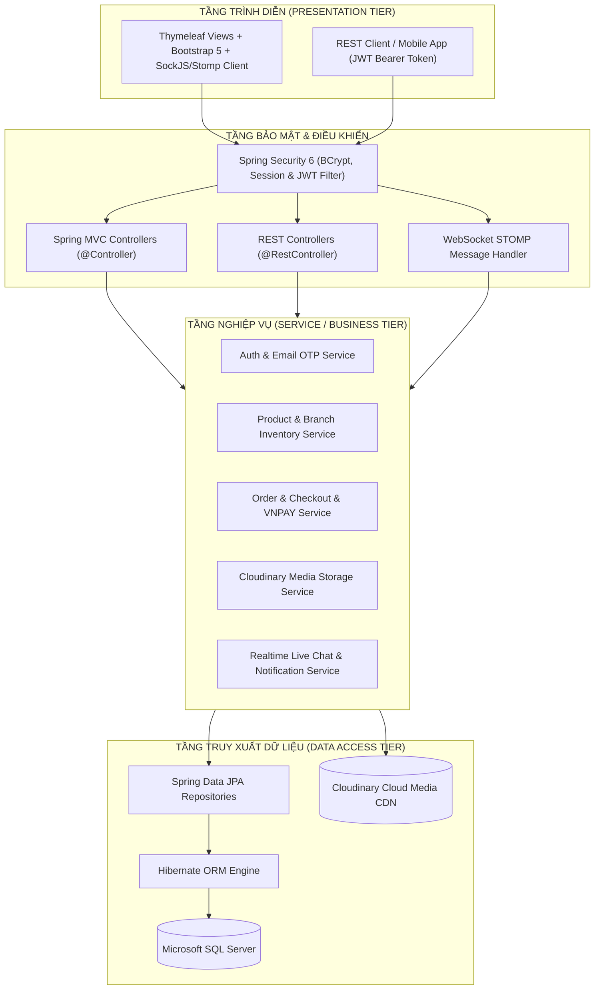

# 📱 ĐỒ ÁN CUỐI KỲ: HỆ THỐNG WEBSITE BÁN HÀNG THEO MÔ HÌNH CHUỖI CỬA HÀNG THIẾT BỊ ĐIỆN TỬ

> **Môn học:** Lập trình WEB  
> **Trường Đại học:** Đại học Công nghệ Kỹ thuật Thành phố Hồ Chí Minh  
> **Khoa:** Công nghệ Thông tin  
> **Thời gian báo cáo:** 7h00 - 18h00 ngày 31/10/2026 tại phòng A5-203  
> **Số thứ tự nhóm:** `Nhóm 24`  
> **Mã đề tài:** `27`  
> **Đề tài:** **Xây dựng website bán hàng theo mô hình chuỗi cửa hàng thiết bị điện tử bằng Spring Boot + Thymeleaf + Bootstrap + JPA + SQLServer + WebSocket + JWT + Cloudinary**  
> **Repository GitHub:** [https://github.com/24110257ak/LTW-Do-an-cuoi-ki.git](https://github.com/24110257ak/LTW-Do-an-cuoi-ki.git)  

---

## 👥 1. THÀNH VIÊN THỰC HIỆN & PHÂN CÔNG NHIỆM VỤ (NHÓM 24)

| STT | Mã sinh viên | Họ và tên | Vai trò | Phân công Module đảm nhận | Tỷ lệ đóng góp |
| :---: | :---: | :--- | :---: | :--- | :---: |
| **1** | 24110292 | **Mai Huy Nhật** | **Nhóm trưởng** | Hệ thống Real-time Live Chat & WebSocket STOMP; Dual Security Filter Chain (JWT & Session); Quản trị Admin Dashboard; Thống kê doanh thu Chart.js. | **33.3%** |
| **2** | 24110257 | **Trần Vũ Anh Khoa** | Thành viên | Cơ chế Banner 3D Rolodex Cylindrical Geometry & Dải Banner Marketing 2D; Tối ưu hóa bộ lọc sản phẩm đa thuộc tính (Dynamic Filter Specifications); Quản lý Giỏ hàng (Cart) & Tra cứu tồn kho chi nhánh; Giao diện Cửa hàng (Storefront). | **33.3%** |
| **3** | 24110304 | **Đặng Nhật Phúc** | Thành viên | Quy trình Đăng ký OTP qua In-Memory RAM Cache (ConcurrentHashMap); Tích hợp API Hành chính VN 3 cấp tại Checkout; Thuật toán Smart Order Routing; Phân hệ Nhân viên chi nhánh; Đóng gói Dockerfile & Cloud Deployment Render. | **33.3%** |

---

## 🎯 2. TIÊU CHÍ ĐÁNH GIÁ ĐỒ ÁN (THANG ĐIỂM 10)

| Tiêu chuẩn đánh giá | Trọng số | Nội dung đáp ứng của Đồ án Nhóm 24 |
| :--- | :---: | :--- |
| **1. Quản lý Git & Phân công nhiệm vụ** | **1.0 đ** | Phân công nhiệm vụ rành mạch, tuân thủ Git Flow chuẩn (`main`, `dev`, các nhánh `feature/*`), lịch sử commit minh bạch. |
| **2. Cấu trúc Project đúng chuẩn 3 tầng** | **0.5 đ** | Chuẩn Spring Boot 3-tier: Controller (Web & API) - Service - Repository - Entity/DTO, phân chia package mạch lạc. |
| **3. Nghiệp vụ, Logic, Validation & Security** | **6.0 đ** | Đầy đủ 5 roles (Guest, User, Vendor/Store Manager, Admin, Shipper), xử lý validation đầy đủ (`jakarta.validation`), bảo mật Spring Security 6 + OTP kích hoạt qua Email/Terminal. |
| **4. Giao diện Đẹp, Thân thiện & Responsive** | **1.0 đ** | Template Bootstrap 5.3 hiện đại, tối ưu di động, máy tính bảng và desktop, trải nghiệm mượt mà. |
| **5. Tính năng Sáng tạo & Nâng cao** | **1.0 đ** | - Xác thực bảo mật kép với **JWT** & Spring Security 6.<br>- **WebSocket STOMP** thông báo đơn hàng realtime và Livechat tư vấn.<br>- Tích hợp lưu trữ CDN **Cloudinary** & Cổng thanh toán **VNPAY Sandbox**.<br>- Hệ thống Quản lý **Chuỗi cửa hàng & Tồn kho đa chi nhánh (Multi-branch Inventory)**.<br>- **Điều chuyển kho liên chi nhánh** với quy trình duyệt & khóa bi quan (PESSIMISTIC_WRITE) chống Deadlock.<br>- **Sổ nhật ký kiểm toán tồn kho (Audit Trail)** & Chống đặt trùng đơn (**Checkout Idempotency**).<br>- **Logistics thông minh (Smart Order Routing):** Định tuyến đơn hàng tự động đến chi nhánh tối ưu theo cấp Quận/Huyện/Tỉnh và tồn kho sẵn có; Biểu phí ship động (Freeship $\ge 5M$).<br>- **Quản trị Giá vốn (COGS) & Lợi nhuận gộp (P&L):** Snapshot giá vốn lịch sử, tính toán lợi nhuận gộp và biên lợi nhuận (%) theo thời gian thực.<br>- **Đối soát dòng tiền COD (COD Cash Reconciliation):** Quản lý thu tiền mặt shipper và quy trình đối soát nộp quỹ chi nhánh.<br>- **Thuật toán tự động đề xuất điều chuyển kho:** Ghép đôi tự động chi nhánh thiếu hàng với chi nhánh thừa hàng dựa trên ngưỡng an toàn (safetyStock).<br>- **Bộ RESTful API chuẩn OpenAPI 3.0 & Swagger UI:** Tài liệu hóa tương tác tại /swagger-ui.html với Bearer JWT Authorize.<br>- **Cổng Giao vận Shipper chuyên dụng (Shipper Portal):** Giao diện riêng biệt tối ưu trên di động (/shipper/orders) giúp tài xế theo dõi tiền COD cần thu, nút gọi khách hàng 1-chạm, xác nhận giao thành công hoặc báo thất bại đối soát vào sổ quỹ chi nhánh.<br>- **Kiểm thử tự động (Automated Testing):** 211 Unit & Integration Tests Java + 45 Integration Tests JavaScript (256/256 Tests Passing - 100% Green).<br>- **Kiến trúc Tải lên Động (Dynamic Hybrid Media Upload) & Đồ họa 3D E-Commerce:** Ánh xạ tài nguyên tĩnh (/uploads/**) theo giáo trình môn học (WebMvcConfigurer), cơ chế Hybrid thông minh (Cloudinary / Local Project Fallback), bộ tư liệu sản phẩm studio vuông 600x600 chuẩn hóa, đồ họa 3D danh mục chính hãng và hệ thống banner tiếp thị tỷ lệ 1:1 responsive.<br>- **Tối ưu trải nghiệm (UX) & Tường lửa Bảo mật:** Tính năng bật/tắt ẩn hiện mật khẩu (Show/Hide Password Toggle), cấu hình HttpFirewall tương thích URL Spring Boot Dashboard (//), phân loại lỗi 404/500 chuẩn mực, chống đặt đơn lặp `checkoutToken` (Idempotency), Tồn kho hiệu ứng FOMO bảo vệ dữ liệu chuỗi, Cảnh báo thu COD trực quan cho Staff, Chuẩn hóa mã băm BCrypt & Cơ chế 1-Click tự động điền form đăng nhập cho hội đồng chấm thi. |
| **6. Khả năng Báo cáo & Trả lời phản biện** | **0.5 đ** | Báo cáo chi tiết, video demo rõ mặt 3 thành viên, nắm vững source code và kiến trúc. |

---

## 🏛️ 3. KIẾN TRÚC HỆ THỐNG & CÔNG NGHỆ BẮT BUỘC

### 3.1. Sơ đồ Kiến trúc 3 Tầng (3-Tier Architecture)



### 3.2. Ngăn xếp công nghệ (Technology Stack)
- **Backend:** Java 17 LTS, Spring Boot 3.3.4
  - `spring-boot-starter-web`
  - `spring-boot-starter-data-jpa`
  - `spring-boot-starter-security`
  - `spring-boot-starter-validation`
  - `spring-boot-starter-mail` (Gửi mã OTP xác thực đăng ký / đổi mật khẩu + Terminal fallback mode)
  - `spring-boot-starter-websocket` (STOMP Protocol Realtime)
  - `com.cloudinary:cloudinary-http44:1.38.0` (Lưu trữ ảnh mây)
  - `io.jsonwebtoken:jjwt` (JWT Token)
- **Database:** Microsoft SQL Server 2019/2022 + SSMS (34 bảng quan hệ, collation `Vietnamese_CI_AS`)
- **Frontend:** Thymeleaf 3, Bootstrap 5.3, Bootstrap Icons, FontAwesome 6, Chart.js, SockJS, STOMP.js
- **Build tool:** Apache Maven

---

## 🏬 4. CHI TIẾT TÍNH NĂNG THEO TỪNG VAI TRÒ (ROLES)

### 4.1. Khách vãng lai (Guest)
- Xem trang chủ với danh sách sản phẩm nổi bật, sản phẩm bán chạy (>10 sản phẩm sắp xếp giảm dần).
- Tìm kiếm từ khóa theo tên máy, hãng sản xuất (Apple, Samsung, Asus, Dell, Sony,...).
- Lọc sản phẩm theo danh mục, khoảng giá, trạng thái còn hàng tại các chi nhánh.
- Xem chi tiết sản phẩm: hình ảnh, thông số kỹ thuật, giá theo phiên bản (ROM/RAM/Màu), các chi nhánh cửa hàng đang còn hàng sẵn.
- Đăng ký tài khoản người dùng mới: Nhập thông tin -> Hệ thống tự động phát sinh **mã OTP và gửi qua Email / Terminal** -> Xác thực OTP kích hoạt tài khoản.
- Đăng nhập (Session Web hoặc API cấp JWT).
- Quên mật khẩu: Nhập email -> Nhận mã OTP qua Email / Terminal -> Đặt lại mật khẩu mới được mã hóa BCrypt.

### 4.2. Khách hàng đã đăng nhập (User / Customer)
- **Trang cá nhân (Profile):** Quản lý thông tin, đổi ảnh đại diện (Cloudinary), đổi mật khẩu, **sổ địa chỉ nhận hàng đa điểm** (địa chỉ nhà, công ty, ghi chú).
- **Trang mua sắm & Khám phá:** Phân trang 20 sản phẩm/trang theo tiêu chí (Mới nhất, Bán chạy nhất, Đánh giá cao nhất, Yêu thích nhất).
- **Yêu thích & Đã xem:** Thêm sản phẩm vào danh sách Yêu thích (Wishlist), lưu lịch sử Sản phẩm đã xem gần đây.
- **Giỏ hàng lưu trữ Database:** Giỏ hàng đồng bộ trên tài khoản, chọn số lượng, chọn biến thể, tự động tính tổng tiền.
- **Mã giảm giá (Coupon / Voucher):** Nhập mã khuyến mãi để được trừ trực tiếp số tiền hoặc % đơn hàng.
- **Đặt hàng linh hoạt (Checkout):**
  - *Hình thức 1:* **Giao hàng tận nhà** (Chọn địa chỉ nhận hàng, chọn phương thức vận chuyển).
  - *Hình thức 2:* **Nhận tại chi nhánh (Store Pickup)** (Chọn chi nhánh cửa hàng thuận tiện nhất để ra nhận máy).
  - *Phương thức thanh toán:* COD (Thanh toán khi nhận hàng) hoặc VNPAY Sandbox (Cổng thanh toán thẻ ATM / QR code).
- **Lịch sử đơn hàng (Order History):** Theo dõi đơn hàng theo 10 trạng thái chuẩn mực của chuỗi bán lẻ:
  1. NEW (Chờ xác nhận)
  2. CONFIRMED (Đã xác nhận)
  3. READY_FOR_PICKUP (Sẵn sàng nhận tại cửa hàng)
  4. SHIPPING (Đang giao hàng)
  5. DELIVERY_FAILED (Giao không thành công - Hàng tạm giữ trên xe shipper)
  6. RETURNING (Đang chuyển hoàn về kho)
  7. RETURNED (Đã hoàn về kho - Thủ kho kiểm đếm thực tế và phục hồi tồn kho an toàn)
  8. DELIVERED (Đã giao thành công / Đã nhận hàng)
  9. CANCELLED (Đã hủy - Tự động hoàn kho & lượt dùng coupon)
  10. RETURNED_REFUND (Đã hoàn tiền)
- **Đánh giá & Bình luận sản phẩm:** Khách hàng chỉ được đánh giá các sản phẩm đã mua thành công; bình luận hỗ trợ nhập nội dung chi tiết (tối thiểu 50 ký tự) kèm tải ảnh thực tế (Cloudinary).
- **Live Chat tư vấn:** Khung chat trực tuyến thời gian thực (WebSocket) trò chuyện với tư vấn viên chi nhánh.

### 4.3. Quản lý Chi nhánh / Cửa hàng (Staff / Store Manager)
- Đăng nhập vào trang quản trị Chi nhánh chuyên biệt (`/staff/**`).
- **Quản lý Kho hàng Chi nhánh (Branch Stock Management):** Nhập và điều chỉnh số lượng tồn kho từng sản phẩm/biến thể trực tiếp tại quầy.
- **Xử lý Đơn hàng Chi nhánh:**
  - Tiếp nhận đơn hàng giao từ chi nhánh hoặc đơn khách hẹn nhận tại chi nhánh.
  - Cập nhật trạng thái: Đơn mới -> Xác nhận -> Đang giao -> Đã giao / Hủy đơn.
  - Nhận thông báo **Realtime (WebSocket STOMP)** chuông và toast nổi tức thì ngay khi có khách đặt đơn mới tại chi nhánh.
- **Bảo mật Phân quyền Chi nhánh Nghiêm ngặt (RBAC):** Nhân viên (Staff) được gán cố định và chỉ được phép quản lý kho, tiếp nhận đơn và tư vấn chat tại đúng chi nhánh trực thuộc trong CSDL; hệ thống chặn tuyệt đối hành vi chuyển chi nhánh tùy tiện để tránh rò rỉ dữ liệu chuỗi.
- **Live Chat Support:** Tiếp nhận tin nhắn tư vấn từ khách hàng và phản hồi trực tiếp thời gian thực.

### 4.4. Quản trị viên Toàn chuỗi (Admin / HQ Manager)
- **Dashboard Thống kê Toàn diện (`/admin/dashboard`):** Thẻ KPI tổng hợp, biểu đồ doanh thu theo chi nhánh (Chart.js bar chart) và biểu đồ cơ cấu trạng thái đơn hàng (donut chart).
- **Quản lý Sản phẩm chung (`/admin/products`):** CRUD sản phẩm, thông số kỹ thuật, cấu hình biến thể (ROM, RAM, Màu sắc), tải ảnh sản phẩm lên Cloudinary CDN.
- **Phân bổ Tồn kho Toàn chuỗi:** Thiết lập số lượng tồn kho ban đầu cho từng biến thể tại 4 chi nhánh cửa hàng.
- **Quản lý Danh mục & Thương hiệu:** CRUD danh mục phân cấp và hãng sản xuất.
- **Quản lý Tài khoản (User Management):** Xem danh sách, kích hoạt/khóa tài khoản, chuyển đổi quyền hạn (CUSTOMER, STAFF, SHIPPER, ADMIN).
- **Quản lý Mã giảm giá (Coupons):** Tạo và quản lý voucher khuyến mãi toàn hệ thống.
- **Quản lý Đơn vị Vận chuyển:** Cấu hình các nhà vận chuyển và bảng phí giao hàng.
- **Quản lý Banner Quảng cáo:** CRUD hình ảnh banner hiển thị ngoài trang chủ.
- **Quản trị Tài chính & Giá vốn (Financial & COGS BI):** Theo dõi tổng doanh thu thuần, tổng giá vốn hàng bán (COGS), lợi nhuận gộp toàn chuỗi và phân bổ theo từng chi nhánh; Phân tích biên lợi nhuận gộp (%) giúp lãnh đạo ra quyết định kinh doanh.
- **Cân bằng Tồn kho Thông minh (Smart Inventory Rebalance):** Cảnh báo các mặt hàng dưới ngưỡng an toàn (safetyStock); Hệ thống tự động đề xuất các lệnh điều chuyển từ kho thừa sang kho thiếu.
- **Quản lý Đối soát COD (COD Cash Reconciliation):** Theo dõi dòng tiền mặt COD đang nằm ở shipper và xác nhận đối soát khi tiền được nộp vào quỹ chi nhánh.

### 4.5. Nhân viên Giao hàng (Shipper - Module Mở rộng)
- Nhận danh sách các đơn hàng được gán đi giao thuộc chi nhánh.
- Cập nhật trạng thái: Đang giao -> Đã giao thành công / Hủy đơn.
- Thống kê đơn giao thành công và tiền COD cần nộp lại.
- **Xác nhận giao hàng & Thu COD:** Shipper xác nhận giao thành công, tự động đồng bộ thu tiền mặt COD.
- **Báo cáo giao hàng thất bại:** Ghi nhận lý do không giao được hàng; Áp dụng cơ chế bảo vệ tồn kho (Reverse Logistics Restock Guard) - không hoàn kho tự tiện khi hàng vẫn còn trên xe.

### 4.6. Hệ thống RESTful API & Swagger OpenAPI 3.0 (Tích hợp JWT)
- **Chuẩn hóa API RESTful:** Hỗ trợ đầy đủ các phương thức HTTP (GET, POST, PUT, DELETE) với cấu trúc phản hồi chuẩn hóa ApiResponse<T>.
- **Bảo mật Token Bearer JWT:** Cấp phát mã JWT sau khi đăng nhập qua /api/auth/login, bảo vệ các API nghiệp vụ quan trọng qua Filter JwtAuthenticationFilter.
- **Tài liệu trực quan tương tác Swagger UI:**
  - Đường dẫn truy cập: http://localhost:8080/swagger-ui.html
  - OpenAPI 3.0 JSON Schema: http://localhost:8080/api-docs
  - Hỗ trợ nút **Authorize** nhập mã Bearer JWT token trực tiếp trên trình duyệt để gọi test API trực tiếp.
- **Danh mục các Controller RESTful đã triển khai:**
  - AuthApiController (/api/auth/**): Đăng nhập, Đăng ký, Lấy thông tin tài khoản hiện hành (/me).
  - ProductApiController (/api/products/**): Tìm kiếm, Lọc đa tiêu chí, Chi tiết sản phẩm & biến thể, Quản trị sản phẩm.
  - CategoryApiController (/api/categories/**): Tra cứu danh mục công khai & Phân cấp danh mục.
  - OrderApiController (/api/orders/**): Đặt hàng (Checkout), Lịch sử đơn cá nhân, Hủy đơn, Shipper giao hàng & Kế toán đối soát COD.
  - FinancialApiController (/api/admin/financial/**): Báo cáo tài chính toàn chuỗi (Doanh thu, Giá vốn COGS, Lợi nhuận gộp), Hiệu quả chi nhánh, Cảnh báo tồn kho an toàn & Đề xuất điều chuyển tự động.

---

## 🌿 5. CHIẾN LƯỢC PHÂN NHÁNH GIT (GIT FLOW STRATEGY)

Để đảm bảo đạt điểm tối đa tiêu chí *"Quản lý, phân công nhiệm vụ các thành viên và có quá trình commit Github"* (1.0 điểm), nhóm triển khai mô hình Git Flow bài bản, minh bạch với các nhánh thực tế đã hoàn thiện và đồng bộ 100% trên Repository GitHub:

```text
main (Phiên bản phát hành chính thức, mốc Fallback an toàn, sẵn sàng chấm điểm & Deploy)
  │
  └── dev (Nhánh tích hợp tổng thể - Integration Branch)
        │
        ├── feature/database-and-entity         (Phase 1: Khởi tạo CSDL 34 bảng, 16 JPA Entities, 8 Enums & Seed Data mẫu)
        ├── feature/security-jwt-and-email-otp  (Phase 2: Spring Security 6 kép, JWT Filter, OTP Email/Terminal & Cloudinary CDN)
        ├── feature/customer-and-public-portal  (Phase 3: Storefront, Catalog 20 sp/trang, Tra cứu tồn kho chi nhánh, Giỏ hàng & Checkout)
        ├── feature/admin-and-staff-portal      (Phase 4: HQ Admin Dashboard, Quản trị sản phẩm/biến thể, Staff Portal chi nhánh)
        ├── feature/inventory-transfer-and-audit-log (Phase 5: Điều chuyển kho liên chi nhánh, Audit Trail, Khóa bi quan PESSIMISTIC_WRITE)
        ├── feature/smart-logistics-and-cogs    (Phase 6: Smart Order Routing, Giá vốn COGS, Lợi nhuận gộp P&L & Đối soát dòng tiền COD)
        ├── feature/rest-api-and-swagger-jwt    (Phase 7: Bộ RESTful API chuẩn OpenAPI 3.0 với xác thực Bearer JWT & Swagger UI)
        ├── feature/product-media-assets        (Phase 8: Chuẩn hóa media sản phẩm chính hãng, ảnh vuông 600x600 & banner sự kiện)
        ├── feature/interactive-ux-animations   (Phase 9: Sân khấu 3D Rolodex Cylindrical Geometry, Category grid bo góc & Live Search)
        ├── refactor/reorganize-controllers     (Phase 10: Tái cấu trúc chuẩn hóa Controller theo từng domain: admin, api, shipper, staff, customer)
        ├── fix/Phuc                            (PR #1 - Phase 11: Đăng ký OTP qua RAM Cache ConcurrentHashMap, API Hành chính VN 3 cấp & Khóa quyền Staff)
        ├── feature/add-chat                    (PR #2 - Phase 12: Hệ thống Real-time Live Chat STOMP WebSocket, CSDL 34 bảng, Idempotency clientMessageId)
        ├── feature/fix-dev-v2                  (Phase 13: Mua ngay bypass giỏ hàng, Checkout tính tiền động, VNPAY mô phỏng, Vòng đời 10 trạng thái đơn hàng, CSDL 34 bảng)
        ├── feature/middle-promo-banner         (Phase 14: Tích hợp Dải Banner Khuyến mãi 2D đồng bộ Admin Banners & Cloudinary CDN)
        └── docs/final-report                   (Phase 15: Báo cáo Word 72 trang, 256 Automated Tests, Docker Multi-stage & Cloud Render PaaS Deployment)
```

### 5.1. Bảng theo dõi các nhánh chức năng thực tế trên GitHub:
| STT | Tên nhánh (Branch Name) | Thành viên phụ trách | Giai đoạn (Phase) | Nội dung công việc thực tế | Trạng thái tích hợp |
| :---: | :--- | :---: | :---: | :--- | :---: |
| **1** | `main` | Cả nhóm | Production / Fallback | Nhánh chính thức, chứa mã nguồn hoàn chỉnh, cấu hình Dockerfile và là mốc fallback triển khai đám mây an toàn. | ✅ Đồng bộ 100% với `dev` |
| **2** | `dev` | Cả nhóm | Integration | Nhánh trung tâm tích hợp toàn bộ tính năng, giải quyết xung đột trước khi mirror sang `main`. | ✅ Đồng bộ 100% với `main` |
| **3** | `feature/database-and-entity` | Trần Vũ Anh Khoa | Phase 1 | CSDL SQL Server 27 bảng, 16 JPA Entities, 8 Enums và dữ liệu khởi tạo. | ✅ Đã merge vào `dev` |
| **4** | `feature/security-jwt-and-email-otp` | Mai Huy Nhật | Phase 2 | Spring Security 6, JWT Filter, OTP Email/Terminal, Cloudinary CDN. | ✅ Đã merge vào `dev` |
| **5** | `feature/customer-and-public-portal` | Trần Vũ Anh Khoa | Phase 3 | Portal khách hàng: Catalog 20 sp/trang, Bộ lọc đa tiêu chí, Giỏ hàng, Checkout, Tra cứu kho. | ✅ Đã merge vào `dev` |
| **6** | `feature/admin-and-staff-portal` | Mai Huy Nhật | Phase 4 | Admin Dashboard, Quản trị biến thể sản phẩm, Phân bổ tồn kho 4 chi nhánh. | ✅ Đã merge vào `dev` |
| **7** | `feature/inventory-transfer-and-audit-log` | Đặng Nhật Phúc | Phase 5 | Điều chuyển kho liên chi nhánh, Audit Trail, Khóa bi quan, Idempotency & Bộ test tự động. | ✅ Đã merge vào `dev` |
| **8** | `feature/smart-logistics-and-cogs` | Đặng Nhật Phúc | Phase 6 | Định tuyến logistics thông minh, Giá vốn COGS, Lợi nhuận gộp P&L, Hoàn kho an toàn & Đối soát COD. | ✅ Đã merge vào `dev` |
| **9** | `feature/rest-api-and-swagger-jwt` | Mai Huy Nhật | Phase 7 | Bộ RESTful API chuẩn OpenAPI 3.0 với xác thực Bearer JWT & Swagger UI tương tác trực tiếp. | ✅ Đã merge vào `dev` |
| **10** | `feature/product-media-assets` | Trần Vũ Anh Khoa | Phase 8 | Thu thập và chuẩn hóa media sản phẩm chính hãng (TGDD, CellphoneS, FPT Shop), ảnh vuông 600x600. | ✅ Đã merge vào `dev` |
| **11** | `feature/interactive-ux-animations` | Trần Vũ Anh Khoa | Phase 9 | Khung trình diễn 3D Rolodex Cylindrical Geometry, Category grid bo tròn, hiệu ứng đàn hồi tìm kiếm. | ✅ Đã merge vào `dev` |
| **12** | `refactor/reorganize-controllers` | Cả nhóm | Phase 10 | Tái cấu trúc package controller gọn gàng theo domain (`admin`, `api`, `shipper`, `staff`, `customer`). | ✅ Đã merge vào `dev` |
| **13** | `fix/Phuc` | Đặng Nhật Phúc | Phase 11 (PR #1) | Bộ nhớ tạm RAM Cache (ConcurrentHashMap) cho đăng ký OTP, tích hợp API Hành chính VN 3 cấp tại checkout, khóa quyền chi nhánh Staff. | ✅ Đã merge vào `dev` (PR #1) |
| **14** | `feature/add-chat` | Mai Huy Nhật | Phase 12 (PR #2) | Hệ thống Live Chat STOMP WebSocket thời gian thực, lưu trữ 27 bảng CSDL, chống gửi trùng `clientMessageId`, phân quyền chi nhánh. | ✅ Đã merge vào `dev` (PR #2) |
| **15** | `feature/fix-dev-v2` | Mai Huy Nhật | Phase 13 | Hoàn thiện tính năng Mua ngay, Checkout tính tiền động, Thanh toán VNPAY mô phỏng, Vòng đời 10 trạng thái đơn hàng, CSDL 34 bảng. | ✅ Đã merge vào `dev` |
| **16** | `feature/middle-promo-banner` | Trần Vũ Anh Khoa | Phase 14 | Tích hợp Dải Banner Khuyến mãi 2D đồng bộ thời gian thực với phân hệ Admin Banners và Cloudinary CDN. | ✅ Đã merge vào `dev` |
| **17** | `docs/final-report` | Cả nhóm | Phase 15 | Báo cáo chi tiết `.docx` (72 trang), cập nhật 34 bảng CSDL, 256 bài kiểm thử tự động, Dockerfile và bộ hồ sơ nghiệm thu. | ✅ Đã merge vào `dev` & `main` |

### 5.2. Quy trình Quản lý Pull Request, Giải quyết Xung đột & Đồng bộ Nhánh:
1. **Quy trình Pull Request chuẩn mực:** Mọi tính năng mới đều được phát triển trên nhánh riêng biệt (`feature/*` hoặc `fix/*`), kiểm thử độc lập trước khi mở Pull Request vào `dev`.
2. **Xử lý xung đột code (Conflict Resolution) thực tế:**
   - Khi sáp nhập PR #1 (`fix/Phuc`) và PR #2 (`feature/add-chat`), xung đột phát sinh tại `StaffController.java` (giữa cơ chế khóa quyền chi nhánh theo Database của Phúc và các endpoint hỗ trợ chat của Nhật) và `admin-sidebar.html`.
   - Nhóm đã tiến hành phân tích mã nguồn chi tiết, kết hợp cả hai giải pháp: giữ nguyên cơ chế bảo mật khóa cứng chi nhánh nhân viên từ DB, đồng thời tích hợp đầy đủ menu và luồng chat tư vấn, bảo đảm 100% test cases đều vượt qua (All tests green).
3. **Chiến lược Đồng bộ Song song `dev` ↔ `main`:**
   - Nhánh `dev` là môi trường tích hợp liên tục và kiểm thử các bản vá hệ thống (System Fixes: SQL Server TDS queries, đồng bộ badge giỏ hàng, bộ lọc trạng thái đơn hàng).
   - Nhánh `main` được đồng bộ 1-1 (Fast-forward) với `dev`, chứa đầy đủ tệp `Dockerfile` đa tầng để đóng vai trò làm **mốc Fallback an toàn tuyệt đối** khi triển khai tự động lên nền tảng đám mây Cloud PaaS (Render.com).

---

## ⚙️ 6. HƯỚNG DẪN CÀI ĐẶT & CHẠY ỨNG DỤNG (SETUP GUIDE)

### Bước 1: Chuẩn bị Môi trường
- Cài đặt **JDK 17** (Kiểm tra bằng lệnh: `java -version`).
- Cài đặt **Microsoft SQL Server 2019/2022** và **SSMS**.
- Cài đặt **Maven 3.8+** hoặc sử dụng Maven Wrapper (`mvnw.cmd`) kèm theo dự án.

### Bước 2: Thiết lập Cơ sở dữ liệu SQL Server
1. Mở SQL Server Management Studio (SSMS).
2. Mở file `database.sql` và nhấn **Execute (F5)** (hoặc chạy bằng lệnh `sqlcmd`).
3. Script sẽ tự động tạo database `electronics_store_chain` cùng toàn bộ 27 bảng và nạp đầy đủ dữ liệu mẫu (10 tài khoản, 4 chi nhánh, 12 sản phẩm công nghệ, 31 biến thể, tồn kho chi nhánh, coupons).

**Cập nhật mapping tiền ngày 30/10/2026:** 16 trường trong 6 Entity đã khai báo `precision = 18, scale = 0` để khớp các cột `DECIMAL(18,0)` trong SQL, tránh Hibernate tự yêu cầu đổi thành `NUMERIC(38,2)` rồi bị ràng buộc `DEFAULT` chặn. Điểm đánh giá vẫn dùng `(3,2)`. Xem phạm vi sửa, cách kiểm tra database và hướng dẫn chạy lại tại [mục 16 của tài liệu thay đổi](docs/THAY_DOI_NGHIEP_VU_20261030.md#16-đồng-bộ-độ-chính-xác-các-cột-tiền-với-sql-server). Nếu dùng JAR, cần đóng gói lại để nhận mapping mới; nếu database từng được Hibernate đổi kiểu, kiểm tra kiểu cột và phần thập phân trước khi chạy với `ddl-auto=update`.

**Sửa biểu đồ trạng thái dashboard admin:** tách chú giải khỏi canvas, cấp riêng vùng vẽ, bổ sung màu riêng cho đủ 10 trạng thái và vòng xám/thông báo khi kỳ được chọn chưa có đơn. Chú giải hiển thị số đơn, tỷ lệ và hỗ trợ ẩn/hiện từng trạng thái; giữ bộ lọc tháng và tooltip %. Chi tiết tại [mục 17 của tài liệu thay đổi](docs/THAY_DOI_NGHIEP_VU_20261030.md#17-sửa-biểu-đồ-trạng-thái-đơn-hàng-trên-dashboard-admin).

**Tab trạng thái lịch sử đơn hàng khách hàng (`/orders`):** giữ nhóm nút và nhãn ban đầu; bấm `>>` chỉ để xem **Sẵn sàng nhận tại cửa hàng**, `<<` quay lại. Tab **Đang giao** gồm đơn đang giao/giao thất bại; **Trả hàng/Hoàn tiền** gồm đơn đang hoàn/đã nhận hoàn/đã hoàn tiền. Mỗi đơn vẫn hiện trạng thái xử lý thực tế. Các nhóm lọc và phân trang theo đúng khách đang đăng nhập. Xem [mục 18 của tài liệu thay đổi](docs/THAY_DOI_NGHIEP_VU_20261030.md#18-khôi-phục-các-tab-gốc-trong-lịch-sử-đơn-hàng-khách-hàng).

### Bước 3: Cấu hình `application.properties`
Chỉnh sửa file cấu hình tại `src/main/resources/application.properties` nếu có thay đổi thông số cục bộ:
```properties
# Cấu hình CSDL SQL Server
spring.datasource.url=jdbc:sqlserver://localhost:1433;databaseName=electronics_store_chain;encrypt=false;trustServerCertificate=true
spring.datasource.username=sa
spring.datasource.password=123

# Cấu hình Cloudinary CDN
cloudinary.cloud-name=your_cloud_name
cloudinary.api-key=your_api_key
cloudinary.api-secret=your_api_secret

# Cấu hình Spring Mail & Chế độ Terminal OTP
# Mặc định terminal-mode=true: in mã OTP trực tiếp ra Terminal/Console khi test (tiện lợi, không cần tài khoản Gmail thật)
app.mail.terminal-mode=true
app.mail.otp-expiry-minutes=5

spring.mail.host=smtp.gmail.com
spring.mail.port=587
spring.mail.username=your_email@gmail.com
spring.mail.password=your_app_password
```

### Bước 4: Khởi chạy ứng dụng
Mở Terminal tại thư mục dự án và thực hiện **1 trong 2 cách**:

**Cách 1 (Nhanh & ổn định nhất - Khuyên dùng):**
```powershell
# Chạy trực tiếp file JAR đã đóng gói
java -jar target/electronics-chain-store-1.0.0-SNAPSHOT.jar
```

**Cách 2 (Sử dụng Maven):**
```powershell
.\mvnw.cmd spring-boot:run
```
Ứng dụng sẽ hoạt động tại: **`http://localhost:8080`**

### Bước 5: Danh sách tài khoản thử nghiệm (Test Accounts)
| Tài khoản | Mật khẩu | Quyền hạn (Role) | Chức năng kiểm thử |
| :--- | :--- | :--- | :--- |
| `admin` | `Admin@123` | `ROLE_ADMIN` | Quản trị viên toàn chuỗi, xem biểu đồ doanh thu, quản lý sản phẩm, phân quyền. |
| `staff_q1` | `Staff@123` | `ROLE_STAFF` | Nhân viên chi nhánh Quận 1, tiếp nhận đơn hàng, chuông realtime, quản lý tồn kho tại quầy. |
| `staff_thuduc` | `Staff@123` | `ROLE_STAFF` | Nhân viên chi nhánh TP. Thủ Đức. |
| `shipper1` | `Shipper@123` | `ROLE_SHIPPER` | Nhân viên giao hàng, cập nhật trạng thái đơn giao. |
| `customer1` | `Customer@123` | `ROLE_CUSTOMER` | Khách hàng mua sắm, đặt hàng giao/nhận tại cửa hàng, chat tư vấn, đánh giá. |

> 💡 **Tính năng tiện ích 1-Click Login:** Tại trang đăng nhập (`http://localhost:8080/auth/login`), thầy cô hoặc người chấm bài chỉ cần **bấm chuột trực tiếp vào bất kỳ dòng tài khoản mẫu nào trong bảng**, hệ thống sẽ tự động điền ngay Tên đăng nhập và Mật khẩu vào form để đăng nhập tức thì mà không cần gõ phím!

### Bước 6: Đóng gói Docker & Triển khai Đám mây (Render Cloud Deployment)

Dự án đã tích hợp sẵn file `Dockerfile` đa tầng (Multi-stage build) tối ưu hóa kích thước image siêu nhẹ với Alpine JRE 17 (~150MB):

**Chạy bằng Docker cục bộ:**
```powershell
# 1. Build Docker image
docker build -t electronics-chain-store:1.0 .

# 2. Khởi chạy container
docker run -p 8080:8080 -e SPRING_PROFILES_ACTIVE=prod electronics-chain-store:1.0
```

**Triển khai trên nền tảng đám mây Render (Cloud PaaS):**
1. Tạo **Web Service** mới trên [Render.com](https://render.com) liên kết với Repository GitHub `https://github.com/24110257ak/LTW-Do-an-cuoi-ki.git`.
2. Chọn nhánh triển khai chính: `dev` (hoặc `main` làm mốc fallback).
3. Runtime: **Docker** (Render sẽ tự động nhận diện `Dockerfile` đa tầng ở thư mục gốc).
4. Cấu hình biến môi trường kết nối Database SQL Server và Cloudinary CDN.

---

## 📁 7. CHECKLIST HỒ SƠ BÁO CÁO CUỐI KỲ (HẠN CHÓT 31/10/2026)

- [x] Khởi tạo Repository GitHub và tài liệu kế hoạch `README.md`.
- [x] Hoàn thành toàn bộ Source Code chức năng trên các nhánh Git Flow chuẩn.
- [x] File script `database.sql` đầy đủ 27 bảng, quan hệ khóa ngoại và dữ liệu mẫu phong phú.
- [x] Cấu hình Terminal OTP Mode tiện lợi cho việc kiểm thử và chấm điểm đồ án.
- [x] File tài liệu báo cáo `.docx` đầy đủ hình kiến trúc, sơ đồ hoạt động, giải thích code, ảnh UI, hướng dẫn cài đặt và bảng tổng hợp Prompt AI.
- [ ] Video demo chức năng có xuất hiện mặt 3 thành viên giới thiệu và thuyết minh.
- [ ] Upload đầy đủ vào thư mục Google Drive mang tên `24`.
- [ ] Tạo sheet mang tên `24` trên bảng điểm chung của lớp và tự chấm điểm theo quy định.

---
*© 2026 Nhóm 24 - Lập trình Web - Đại học Công nghệ Kỹ thuật Thành phố Hồ Chí Minh. Mọi quyền được bảo lưu.*
